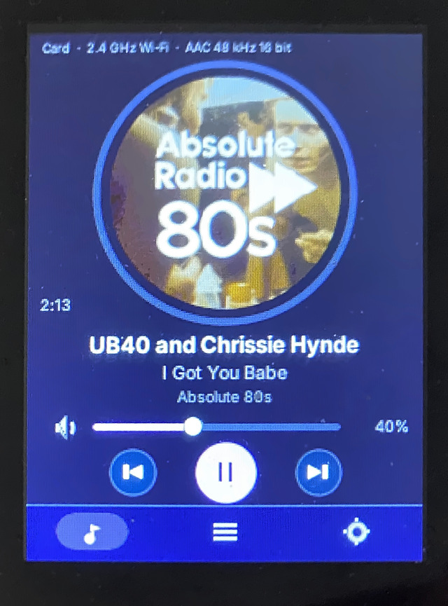

# ESP32-C5 Audio Player



*The working ESP32-C5 Audio Player. Photograph supplied by Peter; perspective-corrected, cropped and lightly retouched. Display content has not been replaced. This photograph shows the panel interface, not the complete CB-1 assembly.*

**One project. One common SD card. Three DAC-specific firmware options.**

Build a standalone audio player around the **Waveshare ESP32-C5-Touch-LCD-2.8**
and **PIXIS CB-1 v2.8**, with an external audio DAC. **No Raspberry Pi is fitted.**
Choose the firmware for your DAC below; the panel setup and SD-card preparation
are shared. You do **not** need to build or install @nerd's original project first.

Based on **Just a Nerd / @nerd / foonerd's [evo-esp32](https://github.com/foonerd/evo-esp32)**.
PIXIS adds the CB-1 integration and the PCM5122 adaptation. The upstream repository
and [configuration wiki](https://github.com/foonerd/evo-esp32/wiki/Configuration)
remain the references for a deeper dive into foonerds evo-esp32 project. This is not Volumio running on an ESP32.

## 1. Choose your firmware

These are the three named options for this project, **not three completed PIXIS
releases**. Foonerd's original PCM5102A and the PIXIS PCM5122 binaries are available below; the PCM5242
variant still needs development and hardware validation.

| Firmware name | DAC / audio board | Binary download | Current status |
|---|---|---|---|
| **C5 Audio — Original (PCM5102A)** | PCM5102A three-wire I2S modules configured for I2S/BCK-derived clocking; @nerd's original baseline | [Original v0.2.0 USB factory binary](https://github.com/foonerd/evo-esp32/releases/download/v0.2.0/evo-esp32-waveshare-esp32-c5-touch-lcd-28-0.2.0.factory.bin) | Official upstream image, not a PIXIS rebuild. PCM5102A is the intended pins-only option; this project does not claim a completed PCM5102A/CB-1 bench test. |
| **C5 Audio — PCM5122** | **Waveshare PCM5122 Audio Board (A)**; Raspberry Pi / IQaudio DAC+ is a separate validation target | [PCM5122 USB factory binary](https://raw.githubusercontent.com/PIXISREPO/PIXIS-PROJECTS/refs/heads/project/esp32-c5-pcm5122/ESP32-C5-AUDIO/firmware/evo-c5-dacplus.factory.bin) | Peter reports successful macOS flashing, expected startup and audio playback on the Waveshare board. Genuine Raspberry Pi / IQaudio DAC+ is **not yet validated**. |
| **C5 Audio — PCM5242** | Raspberry Pi DAC Pro (PCM5242) | **Not available yet — no binary published** | Planned. Driver adaptation, build and DAC Pro hardware testing remain outstanding. Do not use another variant as a substitute. |

Select by **DAC chip and exact board**, not simply by a HAT's product name.
Different HATs are not electrically interchangeable: supply rails, clocking,
I2C control and mute/enable wiring must also match. See [hardware and power
notes](docs/HARDWARE.md) and upstream [Audio out](https://github.com/foonerd/evo-esp32/wiki/Audio-out).
The PCM5122 result is a working bench result, not a guarantee for every PCM5122 HAT.

The firmware choice is made by the **binary you flash**. The `dac` and `output`
settings in the current upstream SD template are reserved for future board
selection; they do not select these three firmware variants.

### Binary checks and flashing

- **Original:** verify against [upstream v0.2.0 SHA256SUMS](https://github.com/foonerd/evo-esp32/releases/download/v0.2.0/SHA256SUMS).
- **PCM5122:** verify against [this project's firmware SHA256SUMS](firmware/SHA256SUMS);
  [BUILD.json](firmware/BUILD.json) records the original build identity.
- Both linked files are **combined USB factory images**, flashed at **0x0**.
  They are not application-only OTA files. Use only with the C5 panel specified
  here (**32 MB flash, 8 MB PSRAM**), not ESP32-S3/C6 panels.
- Follow [macOS backup, installation and recovery](docs/INSTALL-MAC.md).
  Its current filename and checksum commands apply to the **PCM5122** download;
  when choosing Original, use the upstream filename and upstream checksum instead.

The PCM5122 filename remains `evo-c5-dacplus.factory.bin` to preserve the existing
flashing instructions. Its descriptive firmware name above removes the ambiguity:
**the demonstrated board is Waveshare PCM5122 Audio Board (A), not a verified
Raspberry Pi DAC+ installation**. The supplied image has not been rebuilt or re-signed.

## 2. Prepare the common SD card — all three options

**[Download the common SD-card starter package — evo-esp32-sdcard-0.2.0.zip](https://github.com/foonerd/evo-esp32/releases/download/v0.2.0/evo-esp32-sdcard-0.2.0.zip)**

This is @nerd's original **v0.2.0** card package, linked directly from his release,
not a separate PIXIS card image. It is the common configuration/media layout for
the Original and PCM5122 builds, and the intended layout for the planned PCM5242
build. PCM5242 compatibility cannot be bench-confirmed until that firmware exists.
There is **no DAC-specific SD-card build** to choose.

### What the card does

The firmware runs from the panel's flash, **not from the SD card**. The card supplies:

- **Wi-Fi and player settings:** the player reads root-level `evoconfig.txt` at
  startup, including your Wi-Fi name/password, theme, volume and optional network shares.
- **Internet-radio entries:** the `Radio/` folder contains a playlist of station
  names, stream addresses and artwork links. It is not a collection of recorded audio.
- **Optional local music:** add your own music folders and album artwork. Music is
  not included in the download and is not required to listen to internet radio.
- **Status and saved settings:** the player creates `evostatus.txt` and can save
  panel setting changes back to `evoconfig.txt`.

A readable card is required by the current startup sequence even if you intend
to listen only to internet radio or network music.

### What the download contains

```text
evoconfig.txt
Radio/
└── Evo Selection.m3u
```

The ZIP contains **no firmware, operating system, music recordings or bundled
station-logo images**. Station streams and artwork are fetched over the network;
availability, regional restrictions and URLs may change.

### Prepare it once

1. Back up any existing card. Use a **FAT32** microSD card; a 32 GB or smaller card
   is a straightforward starting point. This ZIP is a file package, **not a disk
   image**: extract it and copy its **contents** to the card's root.
2. Confirm the result is `/evoconfig.txt` and `/Radio/Evo Selection.m3u`, **not**
   `/evo-esp32-sdcard-0.2.0/evoconfig.txt`. If Finder has already extracted the ZIP,
   copy the files from the extracted folder.
3. Open `evoconfig.txt` in a plain-text editor. Replace `Your Network` and
   `your password` with your Wi-Fi details. Keep `wifi_band = auto`, or choose
   a band supported by your network. Start with a low volume, for example
   `volume = 10`.
4. **For the PIXIS PCM5122 adaptation, set `update = off`.** Do not install an
   upstream generic update over this custom DAC build. Its signing key differs
   from upstream and an upstream image does not include the PCM5122 adaptation.
   This project currently distributes its PCM5122 image for **USB flashing**, not OTA.
5. Optionally add your own music folders. For radio, choose a station from the
   library after startup. To start one automatically, set, for example:
   `start = Radio/Evo Selection.m3u#Absolute 80s`.
6. Safely eject the card, power the panel off, insert the card into the **panel's
   own microSD slot**, then power on. Check Settings and `evostatus.txt` for the
   Wi-Fi connection. Keep a copy of an existing working configuration rather
   than overwriting it unnecessarily.

The proposed CB-1 rear-access FPC extension is **not yet validated**. Do not assume
CB-1's U8 card socket is connected to the ESP32-C5 without the appropriate adapter.
Wi-Fi and share credentials are stored on the card in **plain text**; never upload
your completed configuration or status file to GitHub. The bundled web interface
credentials are blank by default: review the upstream security settings before
using the player on a shared network.

[SD-card download checksums](https://github.com/foonerd/evo-esp32/releases/download/v0.2.0/SHA256SUMS)
· [Full configuration guide](https://github.com/foonerd/evo-esp32/wiki/Configuration)
· [Minimal alternative Wi-Fi template](config/evoconfig.example.txt)
(the minimal template alone does not include the radio playlist).

## 3. Assemble and validate

Read [hardware and power notes](docs/HARDWARE.md) before wiring. CB-1 v2.8 uses
**U13 for I2S, 5 V and ground**, and **U1 to panel J5 for I2C**. These connector
roles are owner-confirmed; numbered cable pinouts and assembled photographs still
require verification. No Raspberry Pi is needed.

Then follow [installation and recovery](docs/INSTALL-MAC.md) and
[validation / remaining work](docs/VALIDATION.md). Keep amplifier and headphones
disconnected during initial wiring and power checks.

## What remains unchanged

The firmware mounts the panel's microSD card at `/sdcard`, reads its root-level
`evoconfig.txt`, and starts Wi-Fi from `wifi_ssid`, `wifi_password` and optional
`wifi_band`. SD mounting, `config.rs`, `net.rs`, and the Wi-Fi startup block were
compared with the pinned upstream and are unchanged. A card-mount failure idles
before Wi-Fi initialization; no configured SSID means no Wi-Fi connection.

The onboard speaker path remains enabled. The external stream is 16-bit stereo;
this build does not add native 24/32-bit output or 192 kHz operation. A successful
playback report does not validate every configured rate, format or source.

## Source, credit and licensing

Original player: **Just a Nerd / @nerd / foonerd**. This project documents its
PCM5122 adaptation and PIXIS integration; it does not imply upstream endorsement.

[Build instructions and exact source patch](docs/BUILD.md) pin the upstream
commit. The upstream firmware and its modifications retain **Business Source
License 1.1**, not this repository's MIT licence. See [licensing notes](LICENSES/README.md)
and [the complete upstream licence](LICENSES/evo-esp32-BUSL-1.1.txt).
The original licence limits commercial incorporation/distribution without a
separate written agreement. Do not present this as commercially cleared firmware.

Private signing keys, flash backups and real network credentials must never be
added to this project. This is a review-branch project, not a versioned firmware release.
